---
lab:
    title: 'Lab 04: Building Custom Cowork Skills'
    module: 'Module 04: Custom skills'
---

# Lab 4: Building Custom Cowork Skills (Read-only)

**Estimated duration:** 30 minutes

## Overview

In this lab, you see how Copilot Cowork's conversational **skill builder** creates reusable custom skills. You don't fill in forms or write code: you start the builder, answer a short series of questions in plain language, and approve the save while Cowork writes a **SKILL.md** file to your Cowork skills folder in OneDrive.

You will plan a skill on paper, build a **Leadership Update** skill and test it with a sample input, build a second **Project Status Brief** skill, review its quality report and details page, download the skill file and upload it again, run the skill with its trigger phrase, and publish its output to a Teams channel with human approval at the write step.

> **Read-only lab:** To manage Copilot credit consumption during the workshop, **Tasks 2–8 are a guided walkthrough**. Read each step and its screenshot (your trainer may demonstrate them live), but don't run them in your own environment. **Task 1 is hands-on**: it uses only Notepad and costs no credits.

> **Disclaimer:** Cowork is AI-powered, so outputs differ between sessions. The skill builder's questions, their order and the generated content can change.

> **Interface note:** Some screenshots come from an earlier Cowork interface, where the skills page was called **Customize** and **New skill** was labelled **Create skill with Cowork**. In the current interface, use **Plugins** and **New skill**.

## Objectives

- Task 1: Design your skill on paper first
- Task 2: Start the skill builder for the Leadership Update skill
- Task 3: Answer the skill builder questions and save the skill
- Task 4: Test the Leadership Update skill
- Task 5: Build the Project Status Brief skill
- Task 6: Review, inspect and download the Project Status Brief skill
- Task 7: Upload and run the Project Status Brief skill
- Task 8: Post the Project Status Brief to a Teams channel

## Task 1: Design your skill on paper first (hands-on)

A good skill starts with a clear specification. In this task, you answer five planning questions and write a short skill specification in Notepad before touching the builder.

### Open Copilot Cowork

1. Open a browser, go to `https://m365.cloud.microsoft` and sign in with your lab credentials if prompted.
2. Select **New** in the left pane, then select **Cowork** in the task box. Check that the left pane shows **New**, **Search**, **Library**, **Plugins**, **Automations** and **Workspaces**.

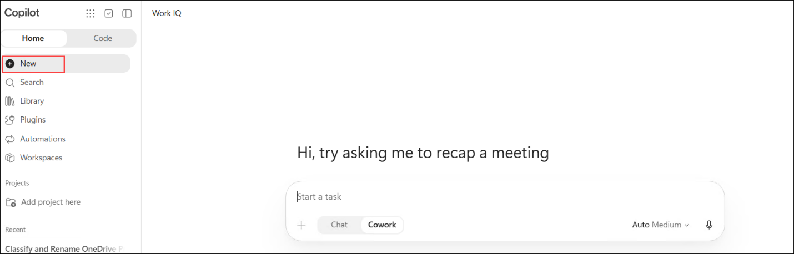

### Capture the planning questions

3. Open the **Start** menu, search for **Notepad** and open it. Resize it so it sits next to your browser.

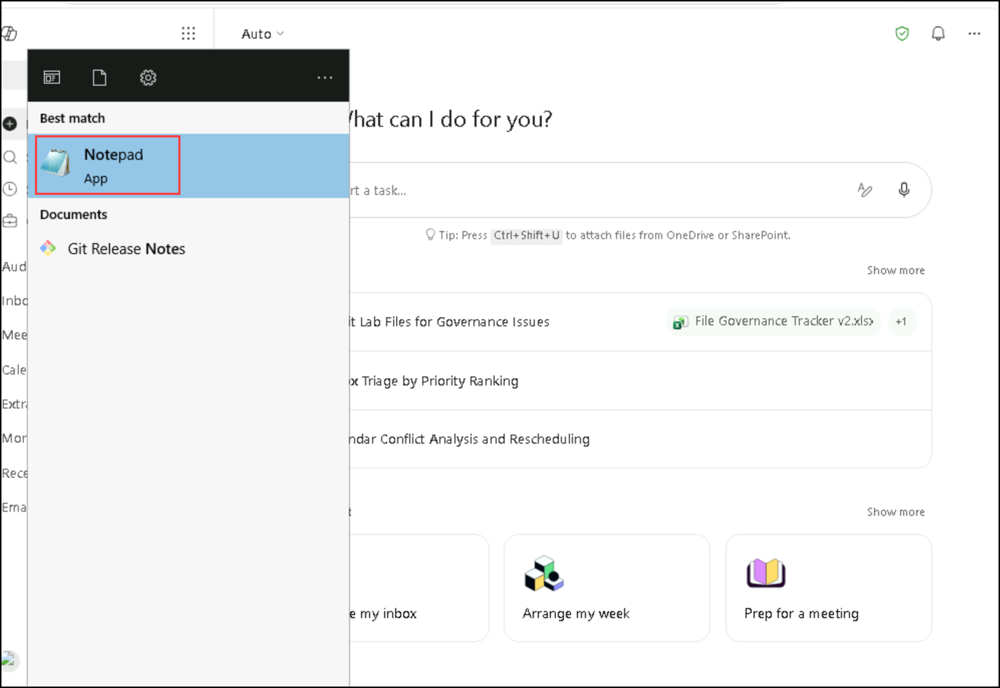

4. In Notepad, enter the five planning questions:

```
What should this skill do?
What does it need to read?
Does it write or change anything?
What should the output look like?
Is there a variable that might change?
```

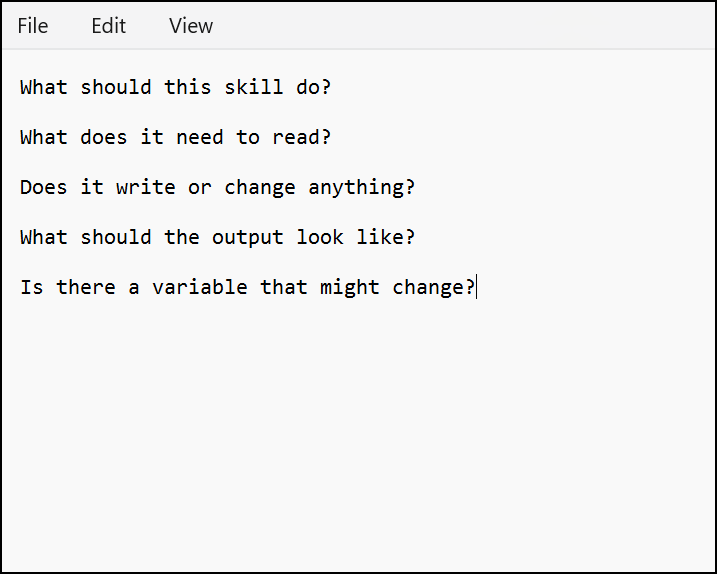

5. Write your answer under each question. If you need help, use these sample answers:

```
What should this skill do?
Turn project, operational or business updates I provide into a concise update for senior leadership.

What does it need to read?
Updates I paste in, plus project content in Teams, Outlook, Word, OneNote or SharePoint.

Does it write or change anything?
No. It only drafts text. It never sends, posts or changes anything.

What should the output look like?
A message of under 200 words with four sections:
- Headline (one sentence with Green / Amber / Red status)
- Progress
- Risks and Blockers
- Asks / Next Steps

Is there a variable that might change?
Yes: project name, reporting period, audience, status details, risks and action items.
```

### Write the skill specification

6. Below your answers, add a **Skill specification** section with these fields and fill them in for the Leadership Update skill:

```
Skill name:
Trigger phrases:
Parameters:
Apps it may read:
Apps it may write:
Output format:
```

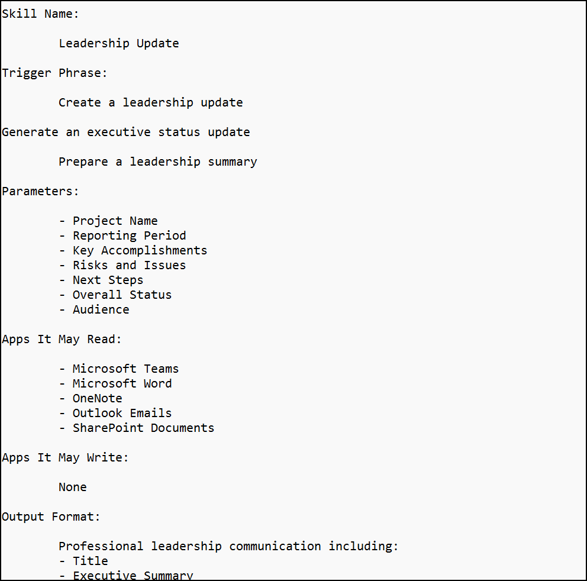

7. If you need help, use this sample specification:

```
Skill name:
leadership-update

Trigger phrases:
- Create a leadership update
- Generate an executive status update
- Prepare a leadership summary

Parameters:
- Project name
- Reporting period
- Audience
- Status details, risks and action items

Apps it may read:
- Microsoft Teams, Outlook, Word, OneNote, SharePoint

Apps it may write:
- None

Output format:
Under 200 words, four sections in this order:
- Headline (overall status: Green / Amber / Red)
- Progress (2-4 bullets)
- Risks and Blockers (with impact if not addressed)
- Asks / Next Steps
```

8. Save the Notepad file and keep it open. You'll use it as a reference in the next tasks. Don't paste the specification into Cowork.

## Task 2: Start the skill builder for the Leadership Update skill (walkthrough)

In this task, the skill builder is started from the **Plugins** page. Instead of a form, Cowork starts a new task and asks a short series of questions.

1. Select **New (1)** in the left pane. In the task box, select **+ (2)**, then **Plugins (3)**.

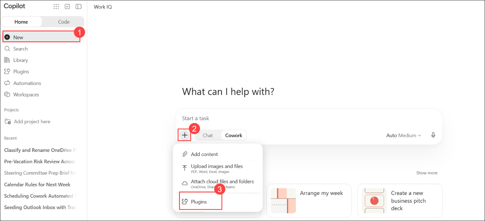

2. On the **Plugins** page, make sure **Cowork** is selected. Select **Add**, then **New skill**.

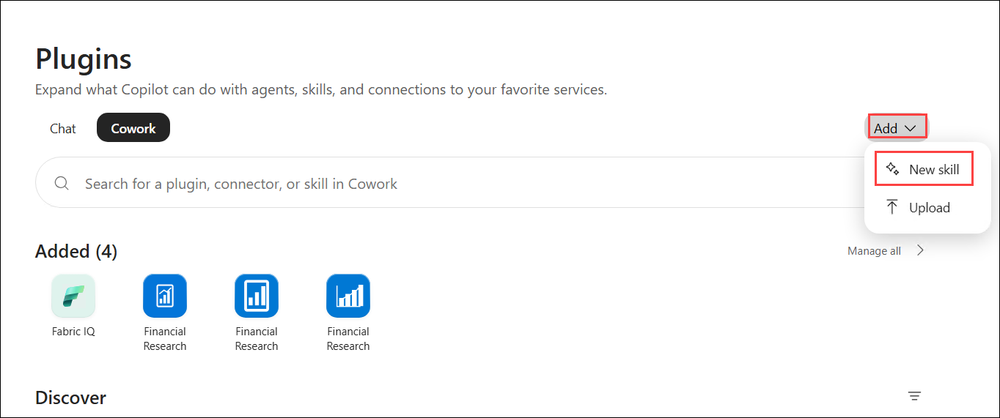

3. Cowork starts a new task and sends this request for you: *"I want to create a new personal skill. Guide me through defining the skill name, description, category, and instructions. Help me write a SKILL.md file and save it to my OneDrive skills folder."* It replies that it will ask a few questions, then draft the SKILL.md for review before saving it.

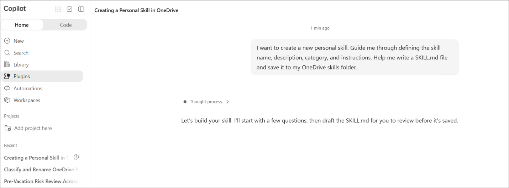

4. A new task, such as **Creating a Personal Skill in OneDrive**, appears under **Recent** in the left pane. The title is generated automatically and may differ.

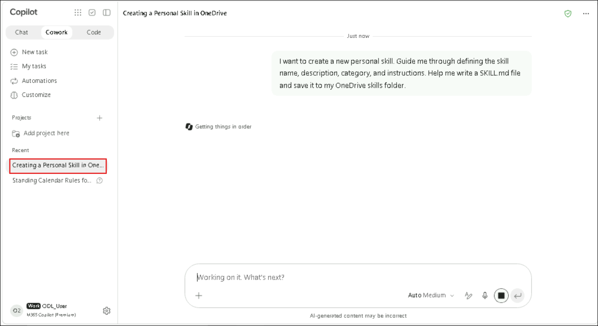

5. The first question card appears above the task box. The counter in its top-right corner (for example, **1 of 5**) shows how many questions there are. Use the **<** and **>** arrows to move between questions, **Skip** to leave one blank and **X** to close the card.

> **Note:** The builder asks four or five questions, and their wording and order can change. Always answer what the question actually asks.

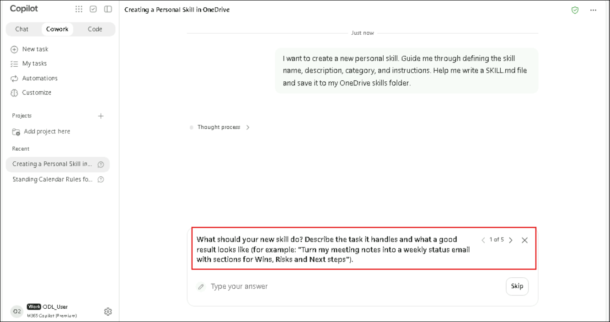

## Task 3: Answer the skill builder questions and save the skill (walkthrough)

In this task, the builder's questions are answered with the Leadership Update specification from Task 1. Cowork then writes the SKILL.md file, checks its quality and asks for approval before saving it to OneDrive.

1. For the question about what the skill should help you do, enter the following and select **Next**:

```
Turn project, operational, or business updates that I provide into a concise leadership / executive update. Read my notes, pull out the overall progress, key accomplishments, risks and blockers, and what I need from leadership. The result should be a short, professional message with four sections: Headline, Progress, Risks and Blockers, and Asks / Next Steps, ready to send to senior leadership.
```

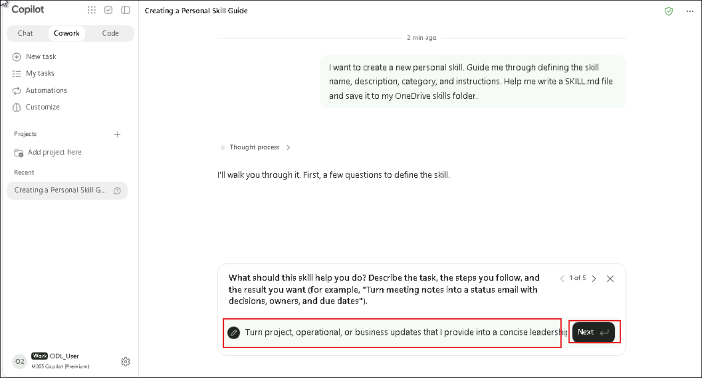

2. For the question about the skill's name, enter the following and select **Next**:

```
leadership-update
```

> **Note:** Skill names use short lowercase words separated by hyphens. If you leave the name blank, Cowork suggests one.

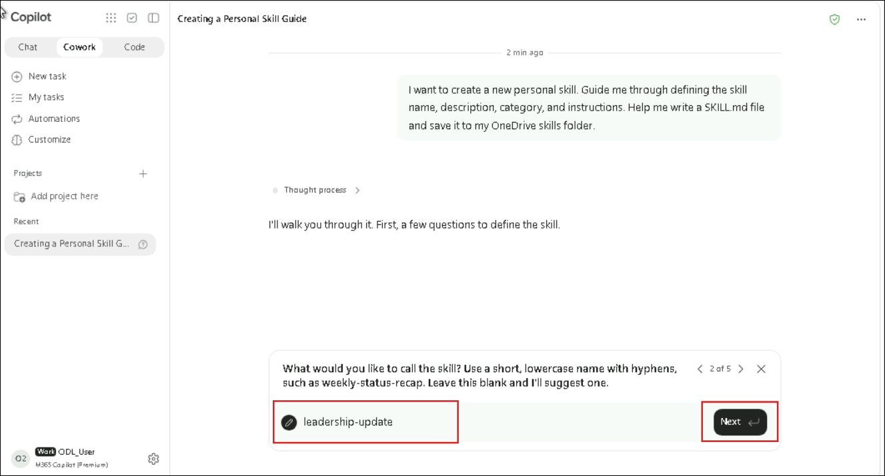

3. For **Which category fits it best?**, select **Communication** and then **Next**.

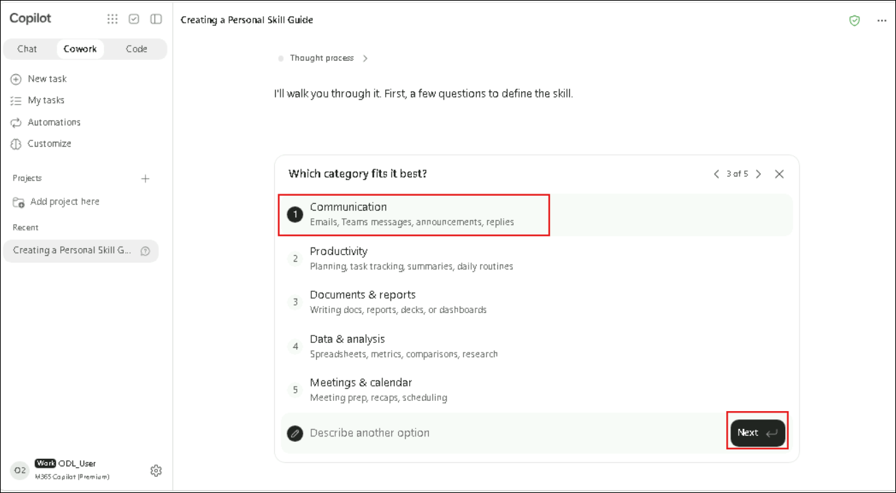

4. For the question about the phrases you'd type to use the skill, enter the following and select **Next**:

```
Create a leadership update, Generate an executive status update, Prepare a leadership summary
```

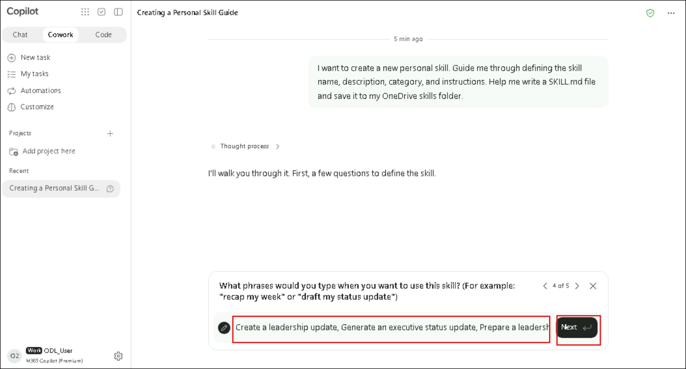

5. For the question about rules the skill should always follow, enter the following and select **Submit**:

```
Tone: professional and concise, suitable for senior leadership. Keep the update under 200 words. Always use four sections in this order: Headline (one sentence on overall status, including Green / Amber / Red), Progress (2-4 bullets), Risks and Blockers (bullets with impact if not addressed), and Asks / Next Steps (specific asks of leadership and upcoming actions). Use only the information I provide or content from Teams, Outlook, Word, OneNote, or SharePoint; never invent figures, dates, or names. Never send, post, or change anything; only draft the update text.
```

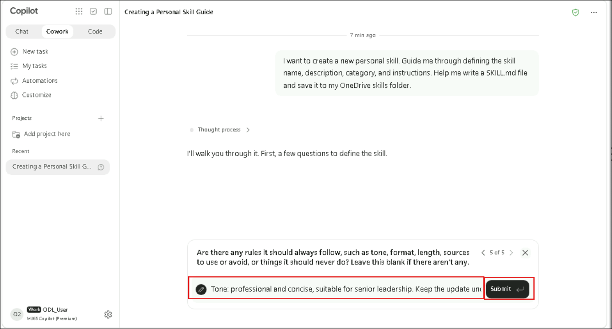

6. Cowork shows **Working on 1 background task** while it creates the skill. The **Workspace** pane opens on the right with **skill-quality-report.html** under **Output** and **Skill Management** under **Plugins**.

7. When the **Copy file** approval card appears, check the details: **To:** *Your Cowork folder / skills / leadership-update*, **Overwrite:** Yes, **Recursive:** Yes, **Source:** *working/leadership-update*. Select **Approve** to save the skill.

> **Note:** Cowork asks for approval before it writes files to OneDrive. If you select **Cancel**, the skill isn't saved.

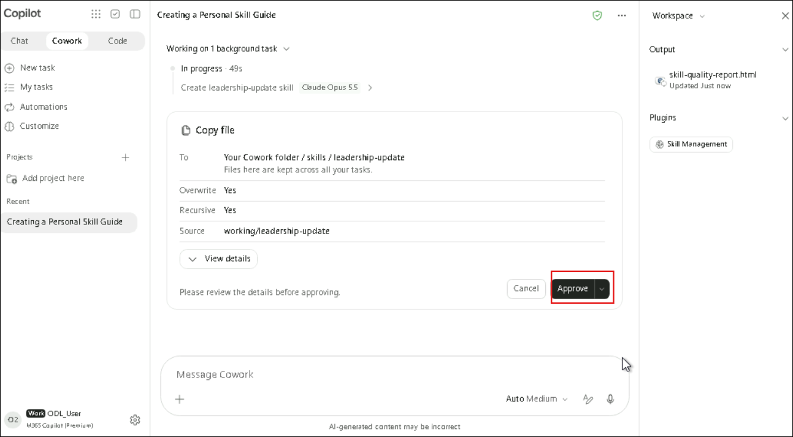

8. Review the completion summary. Under **Changes I made**, Cowork lists any adjustments, for example narrowing the skill so it doesn't overlap with a similar skill you already have. At the end of the response, two cards appear: **leadership-update** (Skill) and **skill-quality-report** (HTML file).

> **Note:** In the screenshots, the account already had a **weekly-status-email** skill, so Cowork mentions it. If you have no similar skills, you won't see that adjustment.

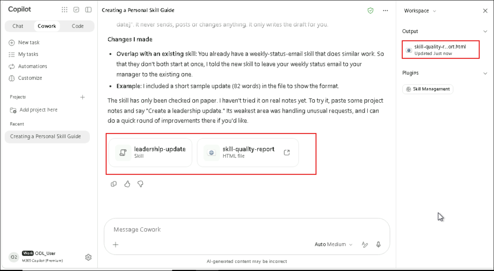

9. Select **skill-quality-report.html** under **Output** in the Workspace pane.

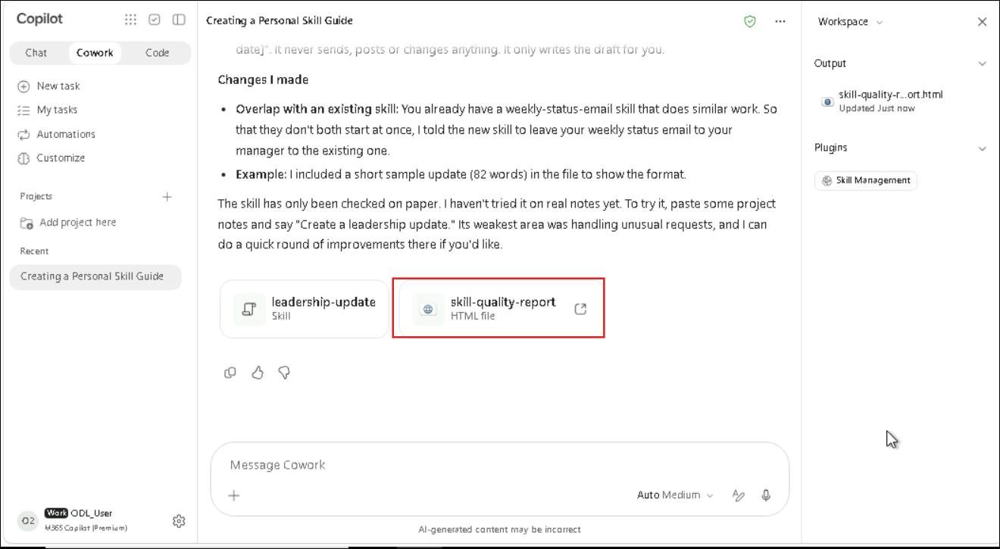

10. Review the quality report: the skill name and the status **This skill is ready to share**, an overall health score out of 100 with **Meets the bar to publish**, the **Risk** and **Grounding** indicators, and the **What's already working** checklist. Then close the preview with **X**.

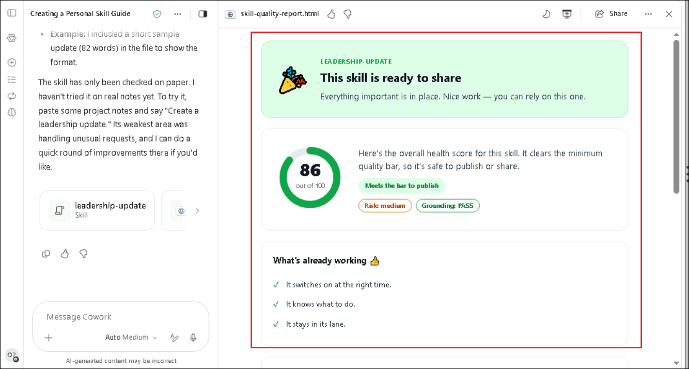

## Task 4: Test the Leadership Update skill (walkthrough)

A skill is only useful if it runs when you call it. In this task, the skill is tested with a sample input to confirm that Cowork uses it.

1. Select **New** in the left pane. Enter the following prompt and select **Send**:

```
Use leadership-update

Summarize the following:

Over the past week, several key initiatives have made progress. Most planned activities are on schedule, although a few tasks are taking longer than expected due to resource constraints. Team collaboration has improved, and stakeholder engagement remains positive. Some risks have been identified that may impact upcoming deadlines if not addressed. Additional support may be needed to maintain momentum.
```

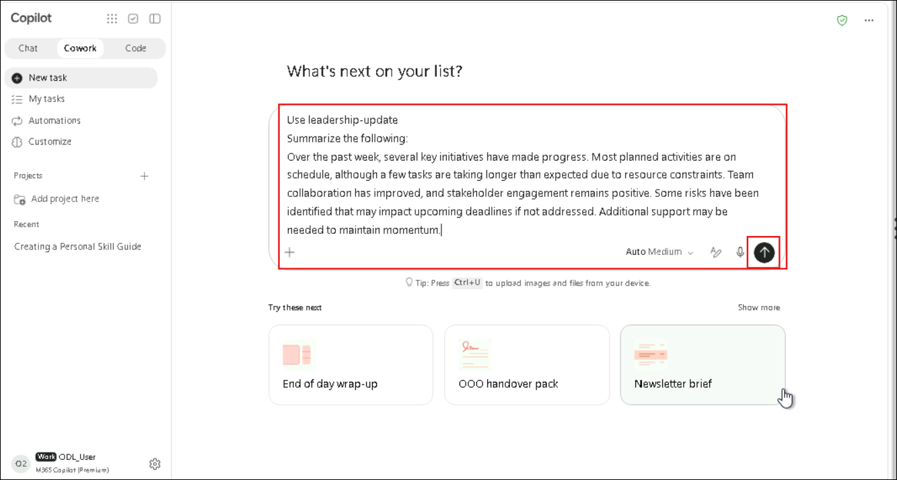

2. Cowork processes the request. The activity log shows **Reviewed custom skill Leadership update**, and **leadership-update** appears under **Plugins** in the Workspace pane. This confirms the skill was used. The update is organized into **Headline**, **Progress**, **Risks and Blockers** and **Asks / Next Steps**.

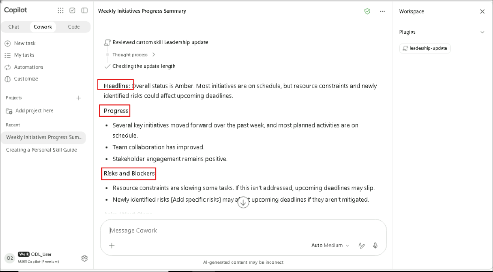

3. Scroll down to review the **Asks / Next Steps** section, the word count and any placeholders such as **[Add date]** or **[Add owner]** that the skill adds where details were missing. At the end, Cowork explains its status rating (for example, **Amber**).

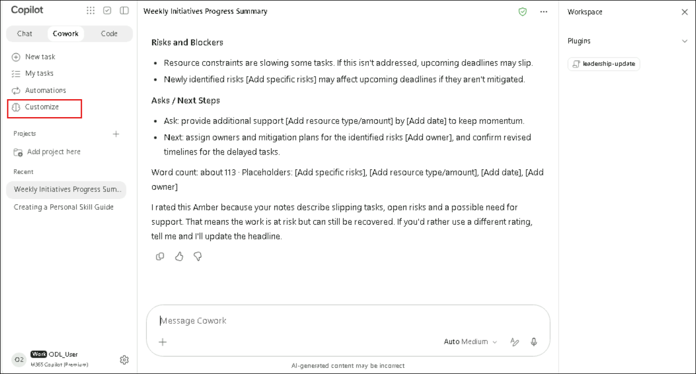

4. Select **Plugins** in the left pane and check that **leadership-update** is listed under **Added**.

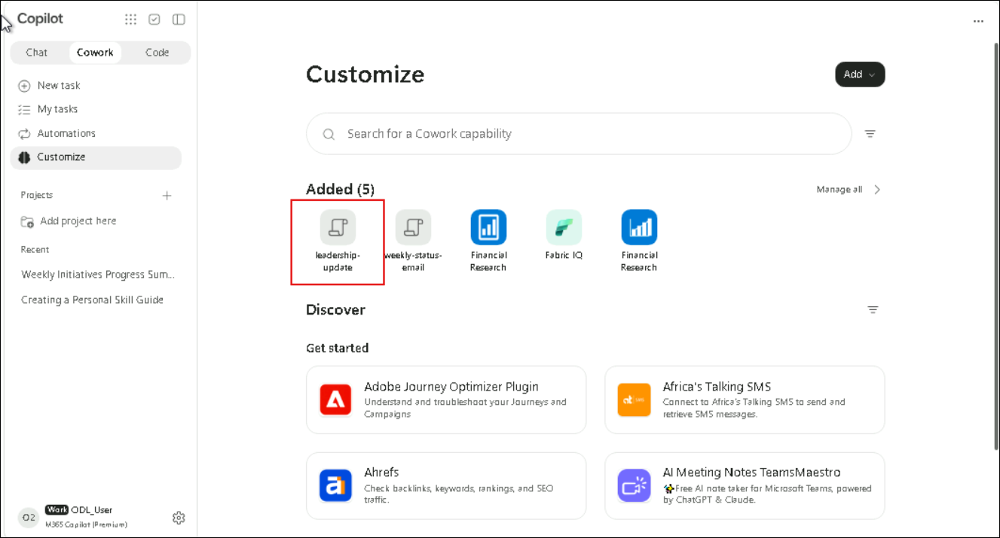

## Task 5: Build the Project Status Brief skill (walkthrough)

The same conversational pattern is now applied to a Project Orion scenario. This time, the builder may ask four questions instead of five, and its first question asks for the task, the trigger phrases and the expected output together.

1. Select **Plugins** in the left pane, make sure **Cowork** is selected, then select **Add > New skill**.

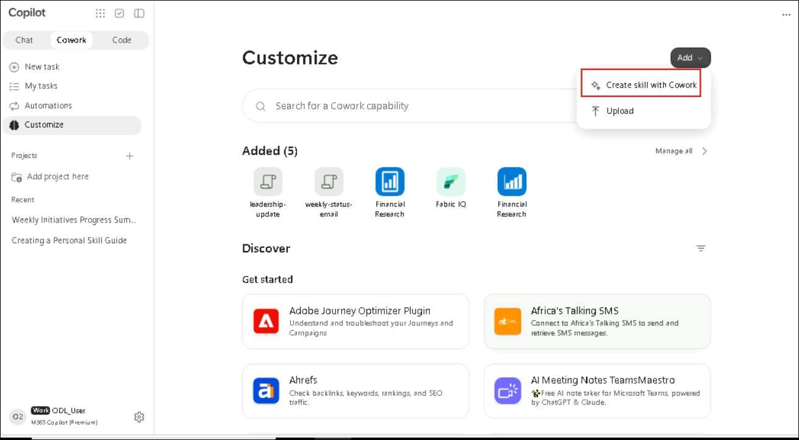

2. For the first question (what the skill should do, when it should trigger and what it should produce), enter the following and select **Next**:

```
Generate a concise project status brief from project updates, meeting notes, task progress, risks, and milestone details that I provide or that are in Teams, Outlook, Word, OneNote, or SharePoint. Trigger when I ask to "create a project status brief", "generate a project update", "summarize project progress", or "give me the project status brief". Produce a professional brief with these sections: Project Overview, Key Accomplishments, Current Status, Risks and Blockers, Upcoming Milestones, and Next Steps.
```


3. For **Which category fits the skill best?**, select **Documents & reports** and then **Next**.

> **Note:** The category options can differ from the first skill. If Cowork can't use the category you pick, it chooses the closest allowed one (for example, **writing**) and tells you in the summary.

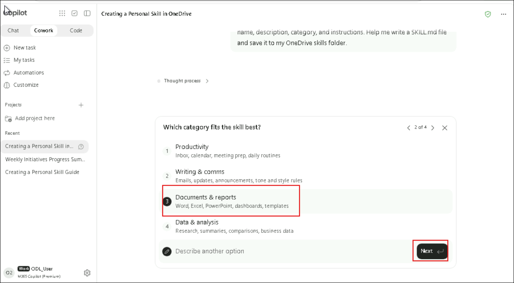

4. For the name question, enter the following and select **Next**:

```
project-status-brief
```

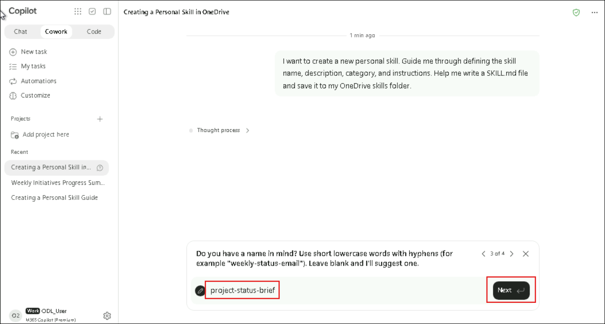

5. For the rules question, enter the following and select **Submit**:

```
Tone: professional and concise. Keep the brief to one page. Always use the six sections in this order: Project Overview, Key Accomplishments, Current Status, Risks and Blockers, Upcoming Milestones, Next Steps. Audience: project stakeholders and leadership. Use only the information I provide or content from Teams, Outlook, Word, OneNote, or SharePoint; never invent figures, dates, or names. Never send, post, or change anything on its own; only draft the brief and wait for my instruction before sharing it anywhere.
```

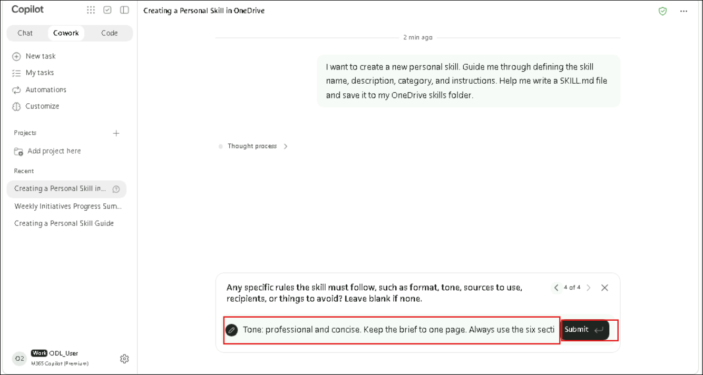

6. When the **Copy file** card appears, check **To:** *Your Cowork folder / skills / project-status-brief* and **Source:** *working/project-status-brief*, then select **Approve**.

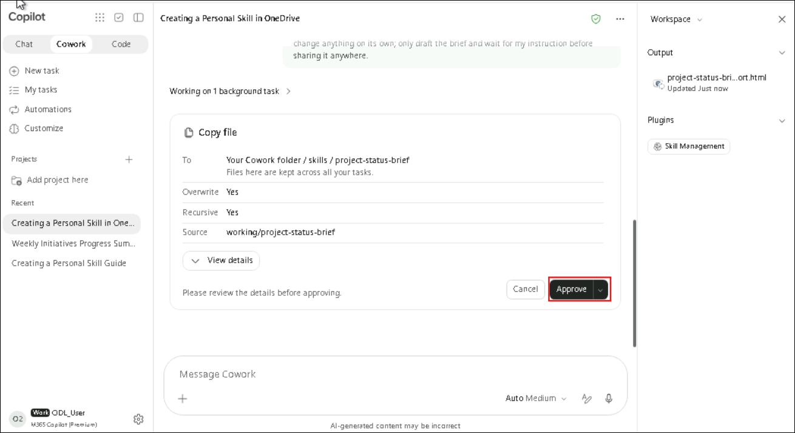

7. Review the completion summary. Cowork confirms the skill was saved to `Documents/Cowork/skills/project-status-brief/SKILL.md` and lists what it put in the skill: the name, the description and the trigger phrases.

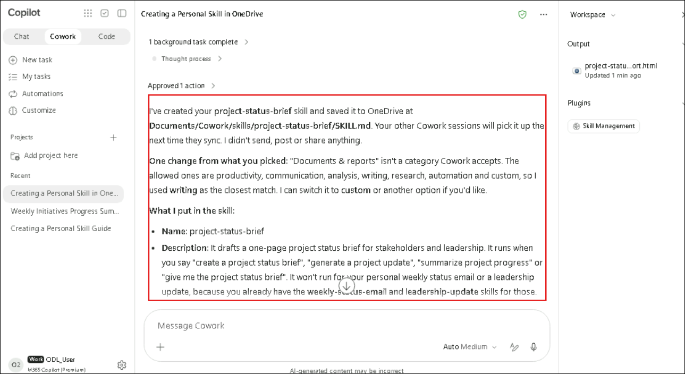

8. Scroll down to the **Format**, **Your rules** and **Checks** sections. The skill passed the format check and received a quality score, and a **project-status-brief-quality-report** card (HTML file) appears at the end.

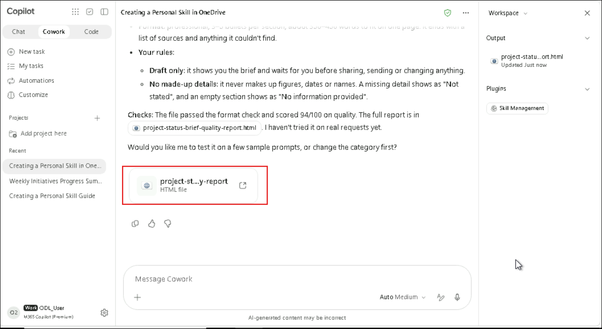

## Task 6: Review, inspect and download the Project Status Brief skill (walkthrough)

In this task, the quality report and the skill details page are reviewed, and the skill file is downloaded for the upload exercise in Task 7.

1. Select the **project-status-brief-quality-report** card. Review the status, the health score, the **Risk** and **Grounding** indicators and the **What's already working** checklist, then close the preview.

> **Note:** The **Risk** rating can differ between skills. In the screenshots, the first skill was rated *Risk medium* and this one *Risk high*. Read why before you share a skill.

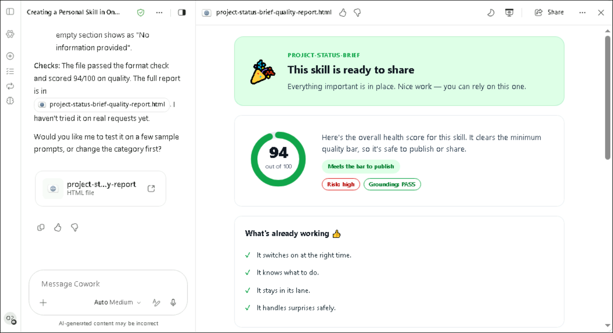

2. Select **Plugins** in the left pane.

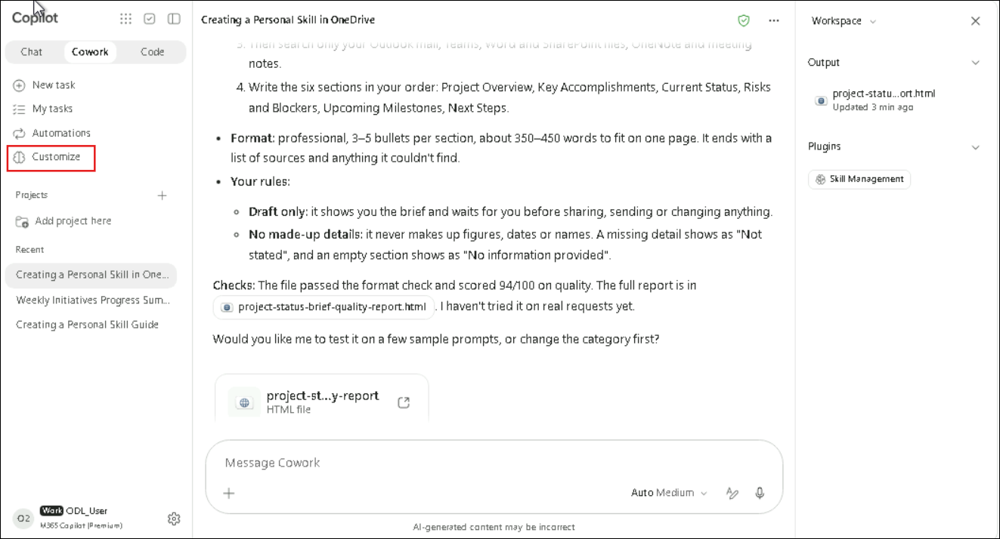

3. Check that **project-status-brief** is listed under **Added**, next to **leadership-update**, and select it to open its details page.

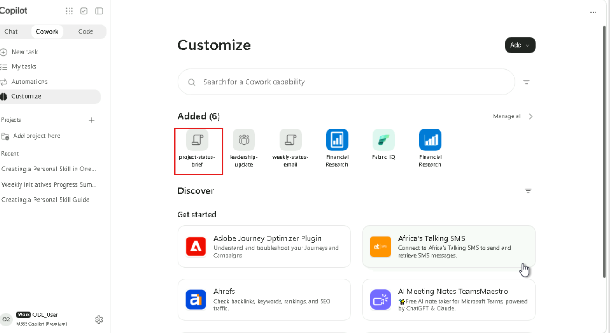

4. Review the details page: the skill name and **Created by you**, the description, and the **Instructions** with **Overview**, **When to Use** and **When NOT to Use** sections. **When NOT to Use** sends other requests to your other skills, such as **leadership-update**. The icons next to **Instructions** let you edit the instructions or open them in a separate view.

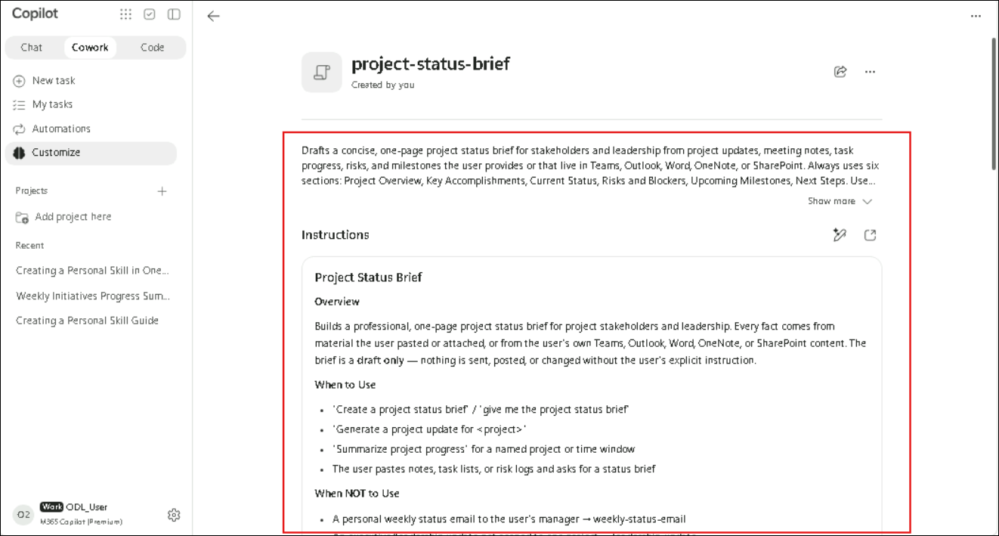

5. Select the ellipsis (**...**) in the top-right corner. Two actions are available: **Download** and **Delete**.

> **Note:** **Delete** permanently removes the skill. Use **Download** to keep a copy before you change or remove a skill.

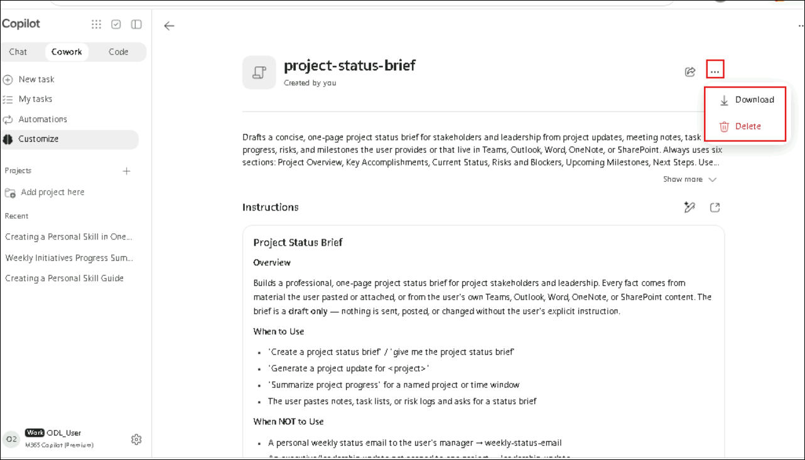

6. Select **Download**.

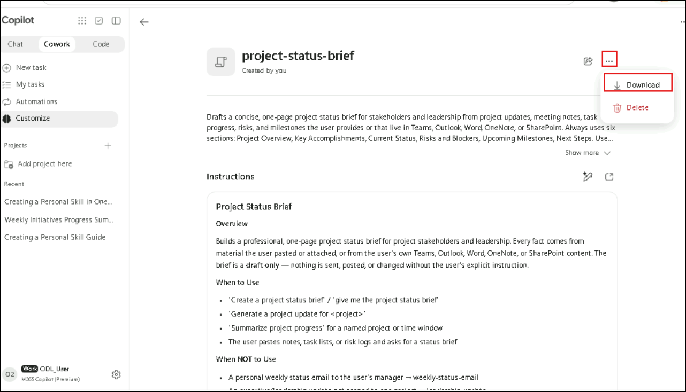

7. The browser's **Downloads** panel shows **project-status-brief.md**. This file is used in the next task.

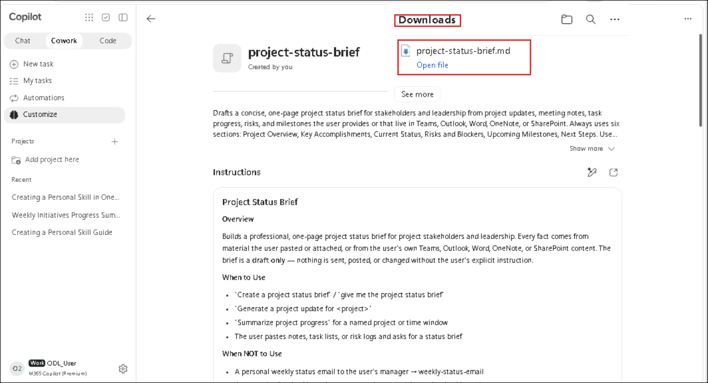

## Task 7: Upload and run the Project Status Brief skill (walkthrough)

Skills can be shared as files and uploaded again. In this task, the downloaded file is uploaded and the skill is run with one of its trigger phrases.

1. Select **Plugins** in the left pane, then **Add > Upload**.

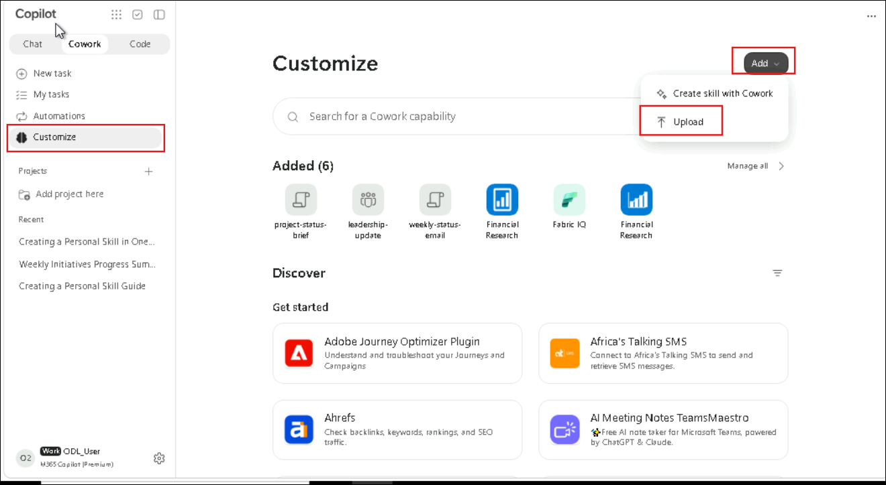

2. The **Upload a skill or plugin** dialog accepts **.MD**, **.ZIP** or **.SKILL** files. Select **choose a file**.

> **Note:** Skills and plugins run as instructions to Cowork and can connect it to external services. Only upload files from sources you trust.

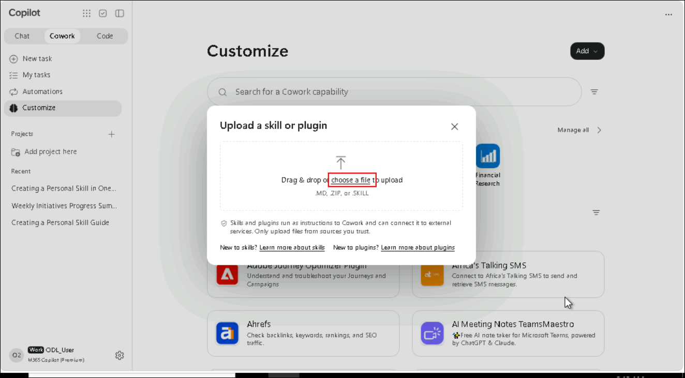

3. In the **Open** dialog, select **Downloads**, select **project-status-brief** and select **Open**.

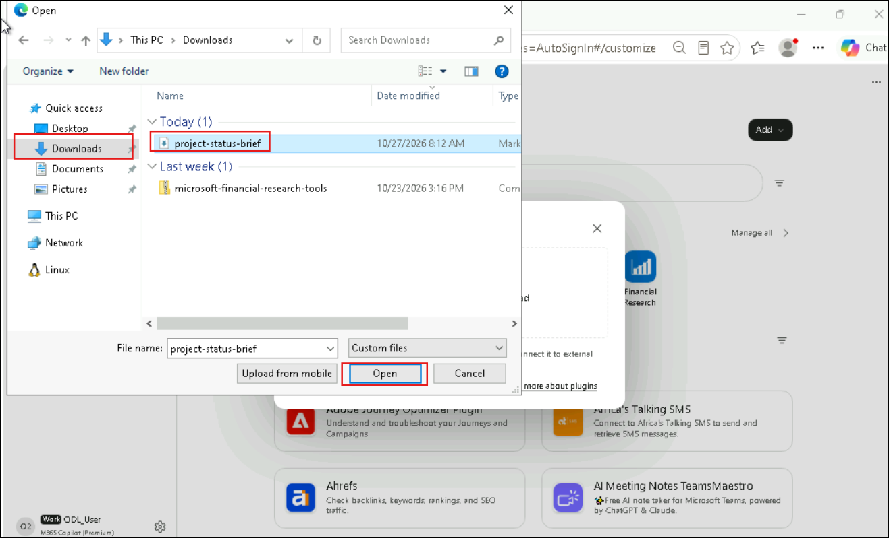

4. The uploaded skill appears under **Added** as **project-status-brief-1**, next to the original. Because a skill named *project-status-brief* already exists, Cowork adds **-1** to the copy.

> **Tip:** Two copies of the same skill share the same trigger phrases, which can confuse Cowork about which one to run. After this exercise, delete the **-1** copy.

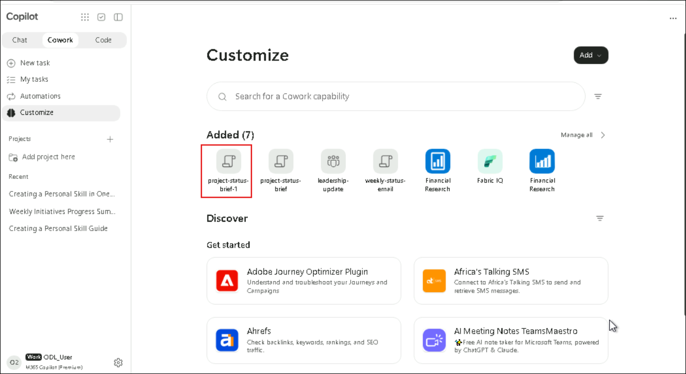

5. Select **New** in the left pane, enter the following trigger phrase and select **Send**:

```
give me the project status brief
```

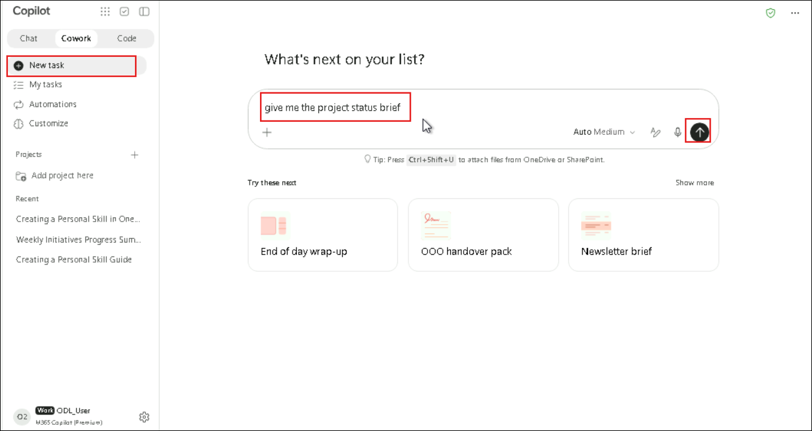

6. Cowork processes the request and a new task, such as **Project Status Brief Summary**, appears under **Recent**. In the Workspace pane, **project-status-brief** appears under **Plugins**, along with the connectors used to find project content, such as **SharePoint**. The brief shows the reporting period and the six sections: **Project Overview**, **Key Accomplishments**, **Current Status**, **Risks and Blockers**, **Upcoming Milestones** and **Next Steps**.

> **Note:** When a detail isn't available, the skill shows **Not stated** instead of making it up.

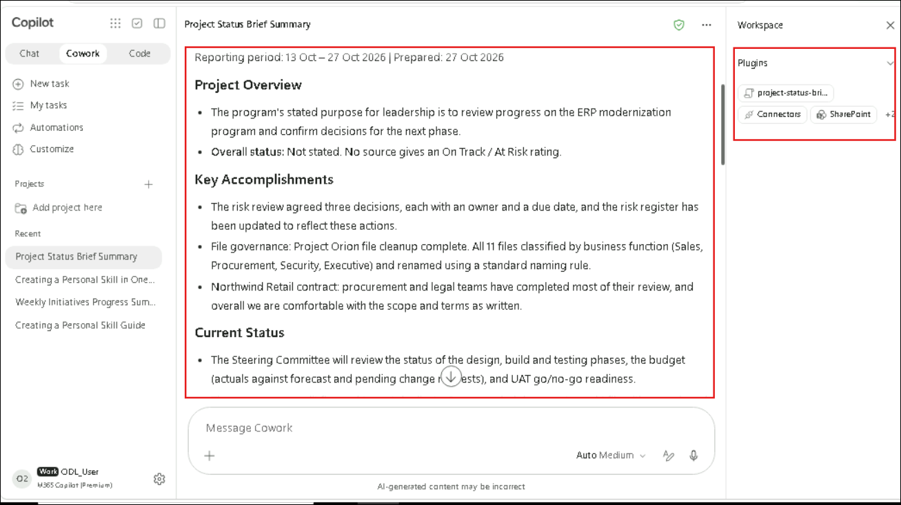

## Task 8: Post the Project Status Brief to a Teams channel (walkthrough)

Skills become most useful when their output goes somewhere useful. In this task, Cowork posts the brief to a Teams channel, and the post is approved before it's sent.

1. In the same task, enter the following in the **Message Cowork** box and select **Send**:

```
Post this brief to the General channel of my Retail team in Teams.
```

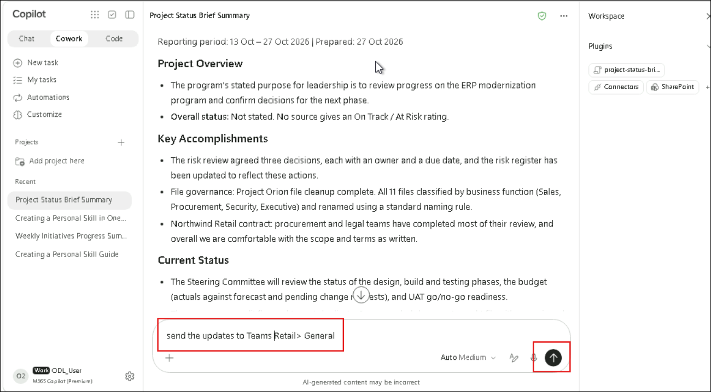

2. Review the **Post to channel?** card: the channel (**#General**), the subject (**Project Orion Status Brief** with the reporting period), the message preview with the brief's sections, and the risk level in the top-right corner. Select **Send** to approve the post.

> **Note:** You can edit the subject and message in the card before sending, or select **Cancel** to stop the post.

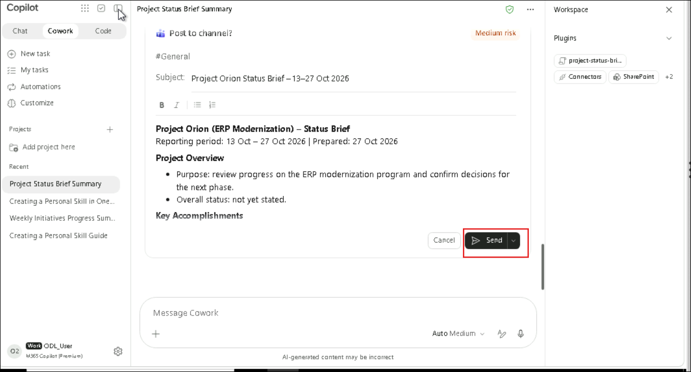

3. Review the confirmation that the brief was posted to the **General** channel of the **Retail** team. Cowork also explains what it left out of the post (such as internal notes) and flags any date conflicts to check. A **General (Posted to Teams)** card appears, and **General** is listed under **Output** in the Workspace pane.

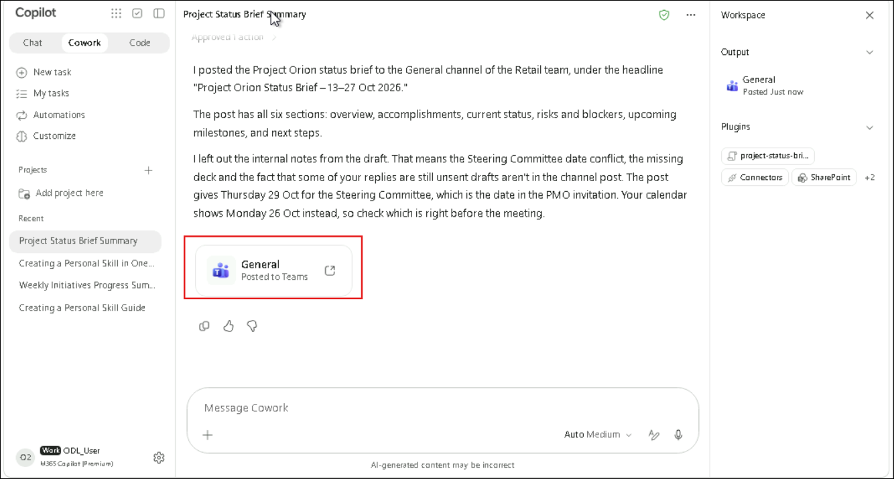

4. Open Microsoft Teams from the open icon on the **General** card, or go to `https://teams.microsoft.com`. If prompted to download the desktop app, select **Use the web app instead**.

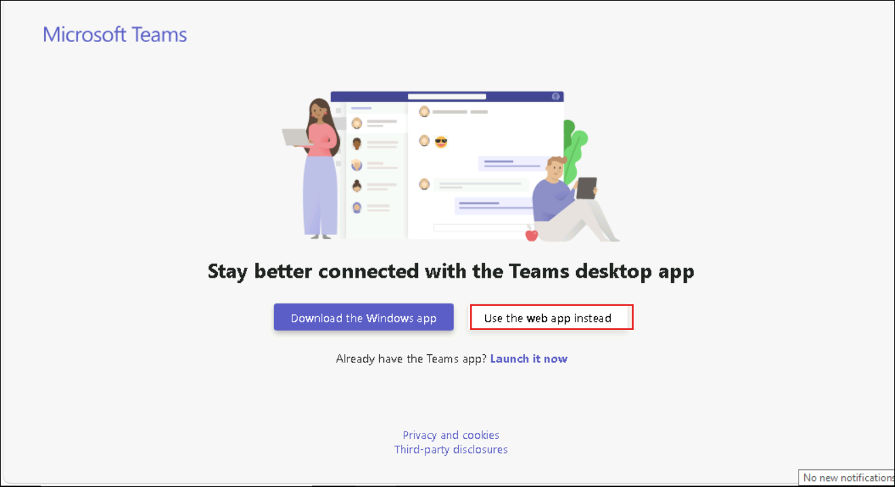

5. Under **Teams and channels**, select **Retail > General**. The **Project Orion Status Brief** post shows the title, the reporting period and the brief's sections. This completes the end-to-end flow: brief generated by the custom skill, post approved in Cowork, message delivered to the channel.

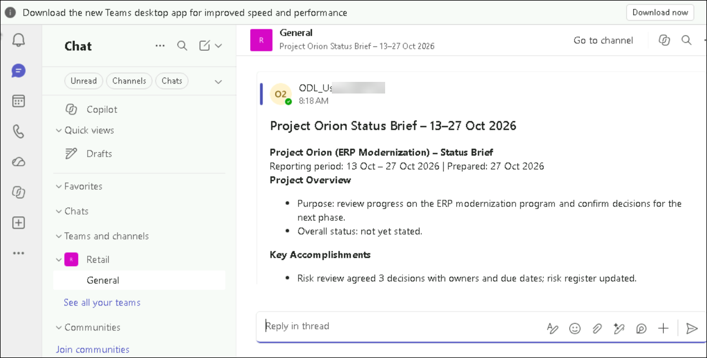

## Review

In this lab, you:

- Planned a skill specification on paper (purpose, inputs, outputs, trigger phrases) before using the builder
- Saw how the skill builder creates the **leadership-update** skill from a short series of questions instead of a form
- Saw the approval step that saves the skill to the Cowork skills folder in OneDrive, and reviewed the skill quality report
- Tested the skill with a sample input and confirmed its four-section output
- Built a second skill, **project-status-brief**, and reviewed its quality report, details page (Overview, When to Use, When NOT to Use) and its **Download** and **Delete** options
- Uploaded the downloaded skill file and ran the skill with its trigger phrase
- Posted the generated brief to a Microsoft Teams channel after reviewing and approving the post
